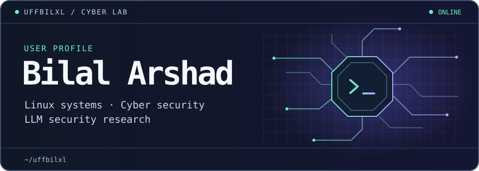

<p align="center">
  
</p>

<p align="center">
  <a href="https://bilalarshad.co.uk/"><strong>Portfolio ↗</strong></a>
  &nbsp; · &nbsp;
  <a href="https://www.linkedin.com/in/bilal-arshad1/"><strong>LinkedIn ↗</strong></a>
  &nbsp; · &nbsp;
  <a href="https://github.com/uffbilxl?tab=repositories"><strong>Repositories ↗</strong></a>
</p>

> **Linux is where I do my best work.** I build test environments, automate repetitive tasks with Bash and Python, and follow the logs or packets when something breaks.

## 01 / Projects from the lab

| Project | What I built or tested |
| :--- | :--- |
| **SentinelIQ** | AI security dashboard built with Python, Streamlit and the Claude API. |
| **Linux administration** | Managed users and permissions, inspected processes and scripted recurring tasks. |
| **Network security labs** | Mapped services with Nmap and inspected traffic with Wireshark in controlled environments. |
| **Cisco network lab** | Configured VLANs and trunk links in Packet Tracer and checked connectivity across segments. |

[Explore my projects and hackathon work →](https://bilalarshad.co.uk/#projects)

## 02 / Current research

**Can automated security tools spot privacy leakage across a conversation?**

My final-year project compares how reliably LLM security testing tools detect privacy leakage from a direct request versus a sequence of messages that builds towards disclosure.

```text
Single turn   →  One direct request for sensitive data
Multi-turn    →  A sequence of prompts building towards disclosure
Evaluation    →  Compare what the tools flag in each setting
```

## 03 / Beyond the lab

I’m a final-year Cyber Security student, **Research Intern** and **Visiting Demonstrator** at Birmingham City University. I lead [BCU Computing Society](https://bcucompsoc.com/), where I help run practical workshops and hackathons, and co-founded **Keystone Digital Strategy**, where I build and deploy client software.

**Two first-place hackathon finishes** · Unihack × Centauri Media · Unihack × Innovation Fest

<details>
<summary><strong>Open the toolkit</strong></summary>

| Area | Tools |
| :--- | :--- |
| Systems & cloud | Linux, Bash, AWS EC2, VirtualBox |
| Development | Python, Git, SQL, MySQL, Streamlit |
| Networking & security | Cisco Packet Tracer, Kali Linux, Nmap, Wireshark, Metasploit |

</details>
